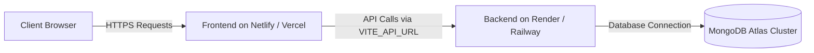

# 🚀 MedConnect Deployment Guide

This guide explains how to deploy both the **Django Backend** and the **React (Vite) Frontend** to free-tier cloud platforms connected directly to your GitHub repository: [`https://github.com/Sudarshan1804/Medconnect`](https://github.com/Sudarshan1804/Medconnect).

---

## 🏗️ Architecture Overview



---

## Part 1: Deploy the Backend (Render or Railway)

### Option A: Render (Recommended & Free Tier)

1. **Sign Up / Log In**: Go to [render.com](https://render.com) and sign in with your GitHub account.
2. **Create New Web Service**:
   - Click **New +** → **Web Service**.
   - Select **Build and deploy from a Git repository**.
   - Select your repository: `Sudarshan1804/Medconnect`.
3. **Configure Settings**:
   - **Name**: `medconnect-backend` (or any unique name).
   - **Region**: Choose the closest region to your MongoDB Atlas cluster (e.g., Singapore, Frankfurt, Oregon).
   - **Branch**: `main`.
   - **Root Directory**: Leave blank (uses repository root).
   - **Runtime**: `Python 3`.
   - **Build Command**:
     ```bash
     pip install -r backend/requirements.txt && python backend/manage.py collectstatic --noinput && python backend/manage.py migrate
     ```
   - **Start Command**:
     ```bash
     gunicorn --chdir backend config.wsgi:application --bind 0.0.0.0:$PORT
     ```
   - **Instance Type**: **Free**.
4. **Add Environment Variables**:
   Click **Advanced** → **Add Environment Variable**:

   | Key | Value | Notes |
   | :--- | :--- | :--- |
   | `USE_MONGODB` | `True` | Directs Django to connect to MongoDB Atlas |
   | `MONGODB_URI` | `mongodb+srv://panjugalasudarshanreddy_db_user:<password>@cluster0.eai5xwr.mongodb.net/hospital_db?retryWrites=true&w=majority` | Replace `<password>` with your Atlas password (ensure `@` is escaped as `%40` if present) |
   | `MONGODB_DB_NAME` | `hospital_db` | Your MongoDB database name |
   | `SECRET_KEY` | *(Generate a 50-character random string)* | Required by Django |
   | `DEBUG` | `False` | Production mode |
   | `PYTHON_VERSION` | `3.11.9` | Ensures compatible Python environment |

5. **Deploy**:
   - Click **Create Web Service**.
   - Once build finishes, Render will provide your public backend URL, e.g.:  
     `https://medconnect-backend.onrender.com`
   - Test it by opening `https://medconnect-backend.onrender.com/api/health/` in your browser (should return `{"status": "ok", "message": "Hospital API is running."}`).

---

## Part 2: Deploy the Frontend (Netlify or Vercel)

### Option A: Netlify (Recommended)

1. **Sign Up / Log In**: Go to [netlify.com](https://netlify.com) and sign in with GitHub.
2. **Add New Site**:
   - Click **Add new site** → **Import an existing project**.
   - Choose **GitHub** and authorize access to `Sudarshan1804/Medconnect`.
3. **Build Settings**:
   - **Base directory**: `frontend`
   - **Build command**: `npm run build`
   - **Publish directory**: `frontend/dist`
4. **Environment Variables**:
   Click **Add variable**:
   - **Key**: `VITE_API_URL`
   - **Value**: `https://your-backend-app.onrender.com/api`  
     *(Replace with your actual Render URL + `/api`)*
5. **Deploy**:
   - Click **Deploy Medconnect**.
   - Netlify will build the production bundle and assign a public URL, e.g., `https://medconnect-hospital.netlify.app`.

---

### Option B: Vercel

1. Go to [vercel.com](https://vercel.com) and sign in with GitHub.
2. Click **Add New...** → **Project**.
3. Import `Sudarshan1804/Medconnect`.
4. Configure:
   - **Framework Preset**: `Vite`
   - **Root Directory**: `frontend` (Click edit and select `frontend`)
   - **Build Command**: `npm run build`
   - **Output Directory**: `dist`
5. Under **Environment Variables**:
   - `VITE_API_URL` = `https://your-backend-app.onrender.com/api`
6. Click **Deploy**.

---

## Part 3: MongoDB Atlas IP Access (Important!)

Ensure MongoDB Atlas allows incoming connections from Render / Railway:
1. Log in to [cloud.mongodb.com](https://cloud.mongodb.com).
2. Go to **Network Access** under Security.
3. Click **Add IP Address**.
4. Choose **Allow Access from Anywhere** (`0.0.0.0/0`).
5. Click **Confirm**. *(PaaS services like Render change dynamic outbound IPs, so `0.0.0.0/0` is required).*

---

## 🔑 Seeding Production Database

To populate the initial admin, doctors, patients, and slots on your deployed database, you can run the management command via the Render Shell tab:
```bash
python backend/manage.py seed_data
```
Or run it locally with your live MongoDB Atlas connection string configured in `backend/.env`.
